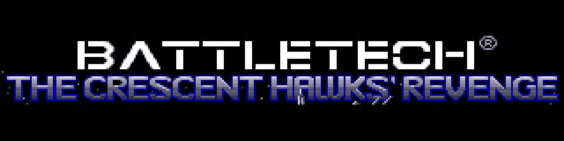
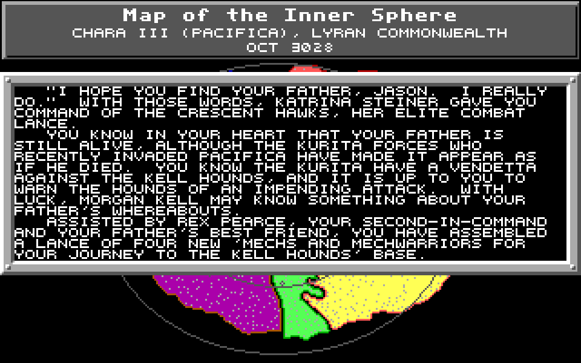

<h1 align="center">
  
</h1>

<p align="center"><em>A readable C17 reconstruction of the 1990 DOS game.</em></p>

This repository is a C17 reconstruction of the 1990 DOS game. Its purpose is
preservation: express the executable's procedures, data flow, control flow and
game rules as readable C while retaining a direct route back to the assembly.

This repository starts at the consolidated v1.0 preservation snapshot. The
monorepo's development commit history is intentionally not imported.

This is not a redesign or the architecture for a future port. DOS, BIOS and
hardware operations are redirected at the lowest practical boundary to SDL3
and portable host services; game logic remains in the reconstructed procedure
chain.

## Current status

Version 1.0 is supported and tested only on 64-bit Windows. The code is intended
to remain portable, but other host platforms are not release-qualified.

- All 785 known executable procedures are present in `src/Original`.
- 588 procedures are `Verified` against assembly.
- 197 procedures are `Verified [SDL]` at a documented platform boundary.
- Two ledger rows are retained as non-procedure evidence.
- No procedure remains `Unchecked` or partially verified.
- All 785 procedures are validated in the readable reconstructed-C model.
- The SDL Release suite contains 59 tests; the asset-independent headless suite
  contains 57.
- Manual acceptance testing has completed the first six campaign missions.

This establishes a functional preservation build, not proof that every
campaign path or hardware nuance has been exercised. See
[`docs/CAMPAIGN_SMOKE_TEST.md`](docs/CAMPAIGN_SMOKE_TEST.md) for the acceptance
record and current limits.

<p align="center">
  
</p>

## Quick start

Requirements:

- Windows with Visual Studio C/C++ build tools;
- PowerShell;
- CMake and Ninja supplied by Visual Studio;
- SDL3 for the playable build; and
- a legally obtained copy of the original game data.

Run the asset-independent build and tests:

```powershell
./Build.ps1 -Headless -Configuration Release
```

For local play, put the original game files in `assets/original-game` and run:

```powershell
./Run-Revenge.ps1
```

Or use an installation elsewhere:

```powershell
./Run-Revenge.ps1 -OriginalAssetDirectory ../Chrevenge
```

The launcher builds `Revenge`, checks for `MEDIA.CFG`, prevents accidental
multiple instances and supplies the asset location without copying the game.
Use `-NoBuild` to run an existing executable and `-Trace` for host-boundary
diagnostics.

## Minimal runtime package

Create a distributable runtime shell with:

```powershell
./Build.ps1 -Configuration Release -Package
```

`build-release/package` contains exactly:

```text
Revenge.exe
REVENGE.CFG
```

The package deliberately contains no copyrighted game data.
`build-release/Revenge-1.0.0-SHA256SUMS.txt` records the SHA-256 of both package
files and is intentionally kept beside the package directory. `REVENGE.CFG`
locates the user's original installation:

```ini
asset_directory=.
```

The default permits the two files to be copied into an original installation.
SDL3 is statically linked into `Revenge.exe`, fixing each release to the SDL
version with which it was built and avoiding a separate runtime DLL.
A relative or absolute path may instead keep program and data separate.
`REVENGE_ASSET_DIRECTORY` overrides the configuration for launchers and test
environments.

## Preservation model

| Area | Responsibility |
| --- | --- |
| `src/Original` | Reconstructed executable procedures and typed executable-owned data |
| `src/Support` | Host representation bridges with no claimed original procedure boundary |
| `src/SDL` | SDL3 and operating-system implementations below original DOS/hardware wrappers |
| `include` | Shared C interfaces and packed data contracts |
| `evidence` | Self-contained annotations, metadata, assembly and research records |
| `docs/METHOD_TABLE.csv` | Address-keyed behavioral verification ledger |
| `docs/SOURCE_CONVERSION_TABLE.csv` | Address-keyed readable-C conversion ledger |
| `tests` | Focused behavior, boundary and preservation checks |
| `tools` | Ledger, evidence and package validation utilities |

The governing rules are in
[`docs/PRESERVATION_PLAN.md`](docs/PRESERVATION_PLAN.md). The reconstructed
source model is described in
[`docs/RECONSTRUCTED_C_PLAN.md`](docs/RECONSTRUCTED_C_PLAN.md). The
[`documentation guide`](docs/README.md) distinguishes current policy from
historical audit records. Supported DOS executable hashes are recorded in
[`docs/SUPPORTED_VERSIONS.md`](docs/SUPPORTED_VERSIONS.md).

Contributions must follow [`CONTRIBUTING.md`](CONTRIBUTING.md), particularly the
original-bug and SDL-boundary rules. Release changes are in
[`CHANGELOG.md`](CHANGELOG.md).

## Verification and diagnostics

`tools/Test-PreservationLedgers.ps1` checks paths, address/name uniqueness,
aliases, final verification states, addressless helpers and direct SDL access
from `src/Original`. Passing tests are regression evidence; the assembly and
observed original behavior remain authoritative.

Normal builds exclude diagnostics injected into reconstructed procedure bodies.
For an explicitly instrumented investigation:

```powershell
./Build.ps1 -Configuration Release -PreservationInstrumentation
./Run-Revenge.ps1 -NoBuild -Trace -OriginalAssetDirectory ../Chrevenge
```

Injected observations use `REVENGE_PRESERVATION_TRACE` so they remain visibly
separate from the reconstructed logic.

## Known limits

- The complete campaign has not been acceptance-tested.
- Presentation and audio are functional but are not cycle- or
  waveform-identical to DOS hardware.
- Stored 16:16 addresses and interrupt-era behavior still require host
  representation bridges where their numeric form is observable.
- Original assets are required for normal play and are not distributed here.

## Rights and licensing

Project-authored code and excluded reconstructed or third-party material are
described in [`LICENSE`](LICENSE), [`LICENSES/README.md`](LICENSES/README.md),
[`NOTICE.md`](NOTICE.md), and [`THIRD_PARTY_NOTICES.md`](THIRD_PARTY_NOTICES.md).
The original executable, raw game assets, saves and extracted asset dumps are
not included. The limited documentation images are covered by `NOTICE.md`.

This is an independent preservation and research project. It is not affiliated
with or endorsed by the game's publishers or the owners of BattleTech.
